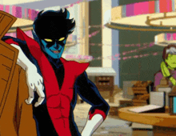

  

#

Me chamo Kauã Katano, tenho 18 anos e moro em Guarulhos - SP. Atualmente curso Engenharia de Software na FIAP. Sou um curioso por tecnologia, curioso sobre Software e Hardware e venho absorvendo os conhecimentos de cursos como Curso em Vídeo e SENAI.
 
#

<h3 align="left">Connect with me!</h3>

<h3 align="left">My Stack ~</h3>

